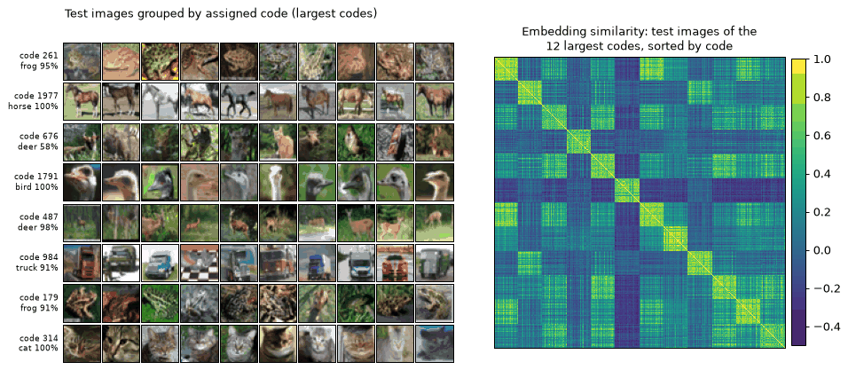

# CPLearn: collapse-proof non-contrastive learning

CPLearn {cite}`sansone2025collapse` is a non-contrastive self-supervised method
whose projector matches embeddings against a **frozen dictionary of random ±1
codes** and whose loss combines **augmentation invariance** with **uniform prior
matching** over the codes. At the minimum of this objective every sample is
assigned to one code and every code is used equally, which rules out
representation and cluster collapse; with (quasi-)orthogonal codes the
embeddings are also decorrelated and clustered. No stop-gradient, momentum
encoder, predictor or clustering step is needed.



*ResNet-18 trained with CPLearn on CIFAR-10 for 1000 epochs (batch 256,
2048 codes). Left: test images grouped by the code they are assigned to, with
the majority class and its share. Right: cosine similarity of the centered
projector embeddings of the test images of the 12 largest codes, sorted by
code: the embeddings form one block per code.*

## How it works

For a batch of `n` image pairs with backbone features `Z` and `Z'`:

1. `H = tanh(BatchNorm(Linear(Z)))` (or `sqrt(f/n) * L2-normalize`, Eq. 1 of the paper).
2. `logits = H @ W / tau`, with a frozen `W` in `{-1, +1}^(f x c)` and
   `tau = f / (sqrt(n) * log((1 - eps * (c - 1)) / eps))`, so that an embedding
   aligned with one code gives that code probability `1 - eps * (c - 1)`.
3. `P = softmax(logits)`, `P' = softmax(logits')`.
4. `loss = beta * CE(P, P') + KL(mean_i P_i || uniform)`, averaged over both view orders.

`CPLearnProjector` implements steps 1-2, `CPLearnLoss` steps 3-4.

## Usage

With the method class:

```python
import torch
from stable_pretraining.methods import CPLearn

model = CPLearn(encoder_name="resnet18", projector_dim=2048, dictionary_size=16384, beta=1.0)
out = model(torch.randn(8, 3, 224, 224), torch.randn(8, 3, 224, 224))
out.loss.backward()
print(out.invariance, out.prior)  # the two loss terms
```

With the forward function and `spt.Module`:

```python
import torch
import stable_pretraining as spt
from stable_pretraining.forward import cplearn
from stable_pretraining.methods.cplearn import CPLearnProjector

backbone = spt.backbone.from_torchvision("resnet18", low_resolution=True)
backbone.fc = torch.nn.Identity()
module = spt.Module(
    forward=cplearn,
    backbone=backbone,
    projector=CPLearnProjector(512, projector_dim=2048, dictionary_size=16384),
    cplearn_loss=spt.losses.CPLearnLoss(beta=1.0),
    optim={"optimizer": {"type": "Adam", "lr": 1e-3, "weight_decay": 1e-4}},
)
```

The forward function logs `{stage}/cplearn_invariance` and
`{stage}/cplearn_prior` next to the loss. A complete CIFAR-10 recipe is in
`benchmarks/cifar10/cplearn-resnet18.py`.

## Options

The paper leaves some details open; the defaults follow the official code,
which produced the reported results, and the paper's variants stay available.

| Option | Default (official code) | Alternative (paper) |
|---|---|---|
| `CPLearnProjector(activation=...)` | `"tanh"` (logits scale with `sqrt(batch size)`) | `"l2"` (Eq. 1) |
| `CPLearnProjector(epsilon=...)` | `1e-8` | `1e-6` (Algorithm 1) |
| `CPLearnLoss(prior=...)` | `"reverse_kl"` | `"ce"` (Eq. 2) |
| `CPLearnLoss(symmetric=...)` | `True` | `False` (Eq. 2) |
| `CPLearnLoss(gather_distributed=...)` | `False` (local batch) | `True` (batch mean over all ranks) |

## Results on CIFAR-10

ResNet-18, 1000 epochs, one GPU; linear probe on frozen backbone features
(Adam, 100 epochs), 20-NN on cosine similarity, clustering NMI between the
assigned code and the label.

| Setting | Linear | kNN | NMI |
|---|---|---|---|
| Paper recipe (batch 64, 16384 codes) | 84.9 % | 83.5 % | 0.471 |
| Batch 256, 2048 codes | 89.8 % | 88.8 % | 0.486 |
| Paper (CPLearn, Table 2) | 91.3 % | – | 0.482 |

Practical notes from the ablations:

- **Batch size.** The prior is computed on the batch mean, so with hard
  assignments it cannot go below `log c - log n`; with the paper's batch of 64
  and 16384 codes training sits on that bound and only a few hundred codes are
  used. A batch of 256 with `dictionary_size=2048` trained clearly better.
- **Prior.** Keep `prior="reverse_kl"`: with a batch much smaller than the
  dictionary, the cross-entropy prior of Eq. 2 collapses to a near-uniform output.
- **beta.** Smaller values use more codes but lower accuracy; too large values
  cause cluster collapse (Table 9 of the paper). `beta=1` worked best here.
